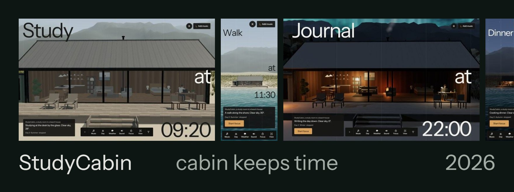
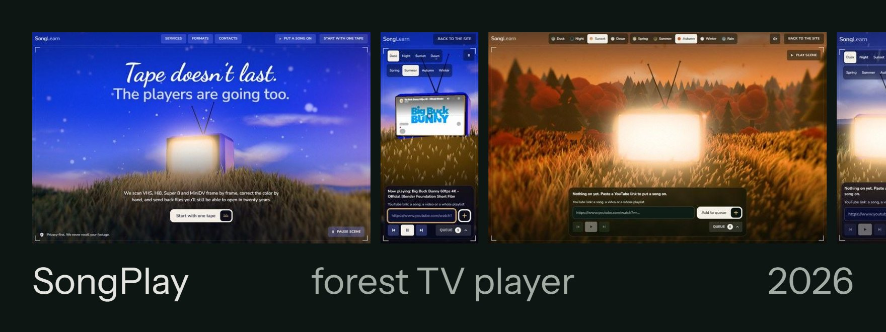
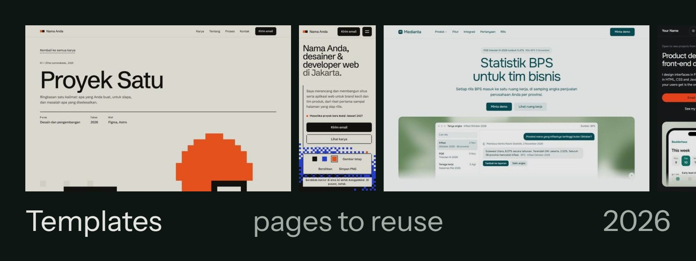
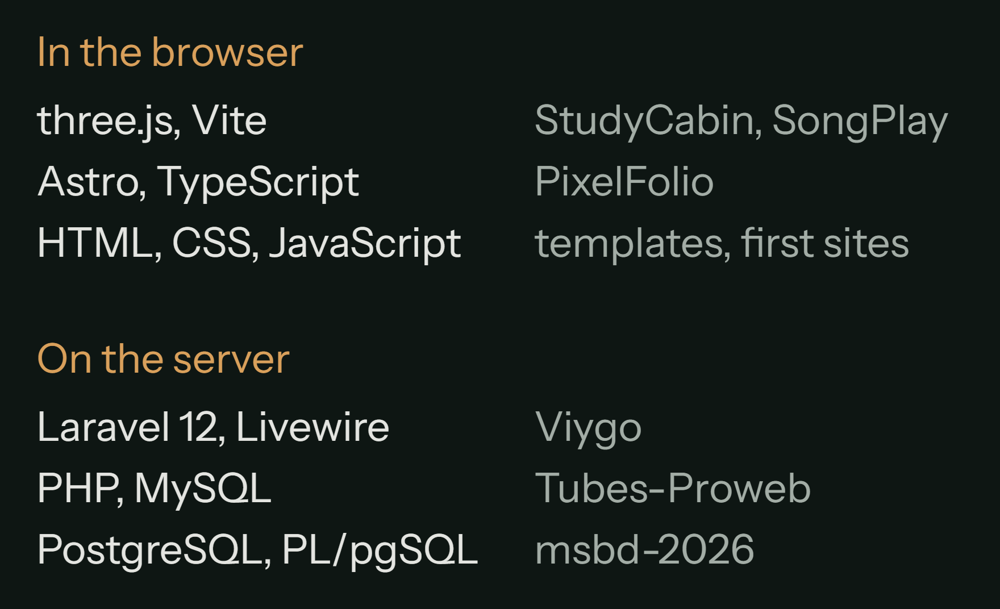
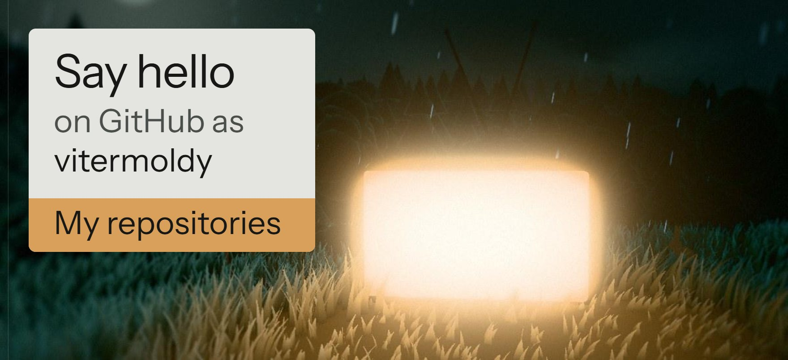

I study Information Technology and build web pages that keep their own clock: a cabin that lives through a 24-minute day, a TV in a forest clearing that plays your YouTube queue, and Laravel and PHP apps with a real database behind them.

<!-- now:start -->
Last push: [StudyCabin-v1](https://github.com/vitermoldy/StudyCabin-v1), 10 November 2026.
<!-- now:end -->

### Work

**StudyCabin** is a study room in a live cabin, built with three.js and Vite. One game minute passes every real second, so a day lasts 24 minutes. The weather turns, five seasons change, and a resident keeps a daily routine while you study to your own YouTube music. [Version 1](https://github.com/vitermoldy/StudyCabin-v1) stands on a misty beach; [version 2](https://github.com/vitermoldy/StudyCabin-v2) moves it into a forest clearing with deer, a fox, and an owl on the roof at night.

**SongPlay** is the landing page for SongLearn, a tape digitizing service. Its first screen is a real-time 3D scene: a glowing CRT television on a grassy knoll, grass moving in the wind, and a cursor that works as a lamp. The player page lines up your YouTube links and plays them on the TV, under the time of day and the season you pick. Code: [version 1](https://github.com/vitermoldy/SongPlay-v1) and [version 2](https://github.com/vitermoldy/SongPlay-v2).

**Templates** for other people to fill in. [PixelFolio](https://github.com/vitermoldy/PixelFolio) ([v2](https://github.com/vitermoldy/PixelFoliov2)) is an Astro and TypeScript portfolio where the cursor leaves a trail of pixels that cool from lime to navy. The [Modern](https://github.com/vitermoldy/Modern-Portofolio-Template) and [Formal](https://github.com/vitermoldy/Formal-Portofolio-Template) portfolio templates are plain HTML and CSS. [Medianta](https://github.com/vitermoldy/Product-Website-v) is a product page, in Indonesian, for a statistics workspace.

### About

**Studying:** Information Technology  
**On GitHub since:** August 2025  
**Writing in:** English and Indonesian

My first pages, in 2025, were a Jujutsu Kaisen fan portal and a calculator in plain HTML. A year on, I build pages that hold a whole day: a clock, the weather, the seasons, animals on their own trails. What I care about is what you only notice when it is missing: type that stays readable at night, a phone layout designed as its own thing, and buttons that do what they say. Before a page ships, it goes through two sets of design rules: [taste-skill](https://github.com/Leonxlnx/taste-skill) and [anti-slop](https://github.com/miqdadbadjuber/anti-slop).

### What I work with

[Viygo](https://github.com/vitermoldy/Viygo-Salon-Web) is a salon search and booking site in Laravel 12, with Livewire Flux, Tailwind CSS 4 and Leaflet maps: search, salon pages with a map, a three-step booking flow and an account area. [Tubes-Proweb](https://github.com/vitermoldy/Tubes-Proweb) is my final project for web programming, a PHP and MySQL social site with posts, comments, likes, follows and three kinds of account. [msbd-2026](https://github.com/vitermoldy/msbd-2026) is a group database project in PostgreSQL and PL/pgSQL.

[All my repositories](https://github.com/vitermoldy?tab=repositories) · [My older portfolio site](https://vitermoldy.github.io/MyPortofolio/)
