<!-- Proudly created with GPRM ( https://gprm.itsvg.in ) -->

  

  <picture>
    <source media="(prefers-color-scheme: dark)" srcset="https://readme-typing-svg.demolab.com?font=Tiny5&size=22&duration=2800&pause=900&color=F0B429&center=true&vCenter=true&width=640&lines=Information+Technology+Student;I+build+cozy+3D+worlds+with+three.js;Laravel+%2B+PHP+%2B+MySQL+on+the+back+end;Pixel+art+lover%2C+see+PixelFolio">
    
  </picture>

  

  

<h2></h2>

- 🎓 **Information Technology** student
- 🔭 Currently building **Nyxborne v2**, a pixel-art summoner RPG where every monster you beat can rise again in your army
- 🌱 Learning more **three.js**, **Laravel 12** and **Astro**
- 👾 Into pixel art, cozy 3D scenes and the small details
- 📸 Off the keyboard: photography, event organizing and multimedia
- 💬 Ask me about three.js, Laravel, PHP and MySQL
- ⚡ Fun fact: in StudyCabin a whole day lasts 24 minutes
<!-- - 📍 Based in KOTA KAMU -->
<!-- - 🏫 Studying at NAMA KAMPUS KAMU -->

<h2>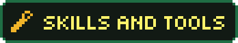</h2>

<b>LANGUAGES</b>

  
  
  
  
  

<b>FRONTEND AND 3D</b>

  
  
  
  
  

<b>BACKEND AND DATABASE</b>

  
  
  
  
  

<b>TOOLS AND CLOUD</b>

  
  
  
  

<b>CREATIVE</b>

  
  
  

<h2>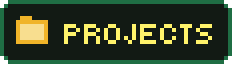</h2>

<table>
<tr>
<td width="50%" valign="top">
  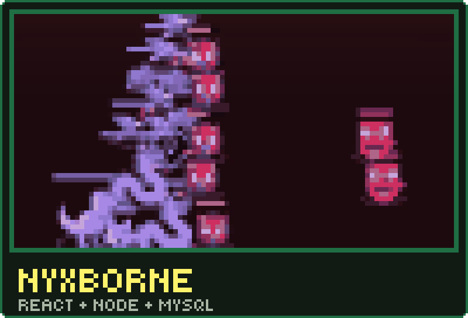
   A dark-fantasy summoner RPG in pixel art. The hunter wears whatever you equip, 36 monsters walk and strike, and every sprite is painted by code. Beaten monsters rise as Nyxborne and stack into colonies hundreds strong, across 124 sub-gates from rank E to Monarch, with match results kept in MySQL. Still in development, so the repository is private for now.
</td>
<td width="50%" valign="top">
  <a href="https://github.com/vitermoldy/idle-Agent-factory">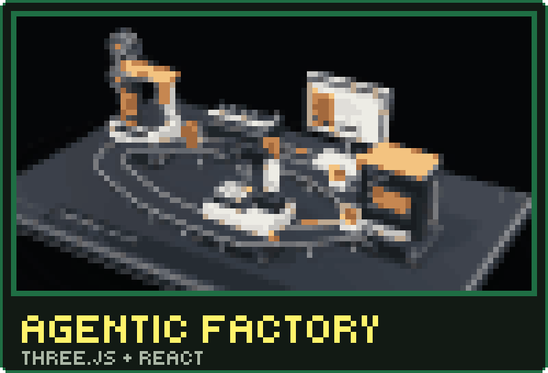</a>
   An idle game on a 3D machine: five production lines run by agents, from a video studio to an e-book publisher. Every product you add builds its own plate beside the others, and the slowest station sets the pace. <a href="https://github.com/vitermoldy/idle-Agent-factory">Repo</a>
</td>
</tr>
<tr>
<td width="50%" valign="top">
  <a href="https://github.com/vitermoldy/StudyCabin-v2">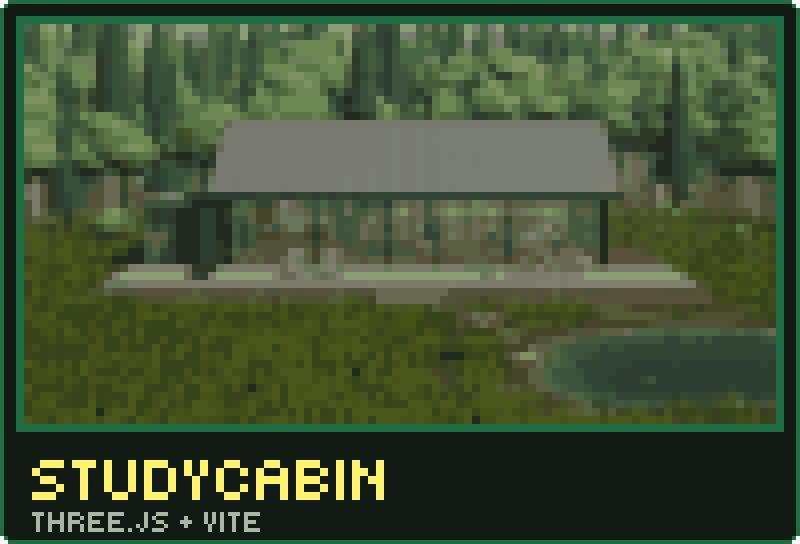</a>
   A study room in a live 3D cabin. A day lasts 24 minutes, with weather, five seasons, animals and your own YouTube music. <a href="https://github.com/vitermoldy/StudyCabin-v1">v1</a> · <a href="https://github.com/vitermoldy/StudyCabin-v2">v2</a>
</td>
<td width="50%" valign="top">
  <a href="https://github.com/vitermoldy/SongPlay-v2">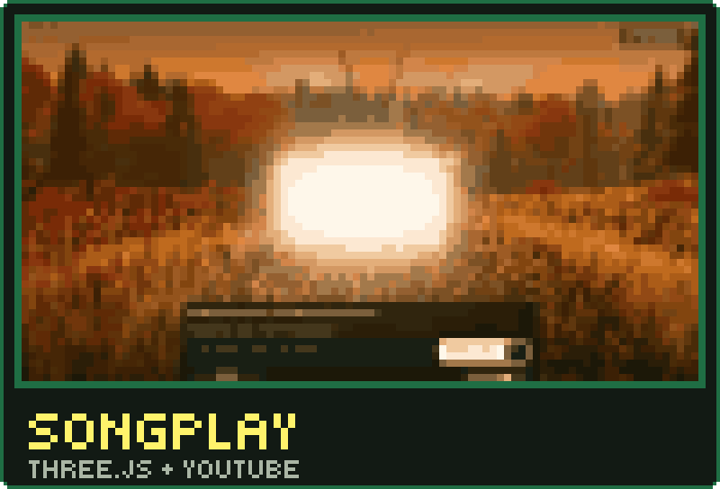</a>
   A glowing CRT TV in a 3D forest clearing that plays your YouTube queue, under the time of day and season you pick. <a href="https://github.com/vitermoldy/SongPlay-v1">v1</a> · <a href="https://github.com/vitermoldy/SongPlay-v2">v2</a>
</td>
</tr>
<tr>
<td width="50%" valign="top">
  <a href="https://github.com/vitermoldy/PixelFoliov2">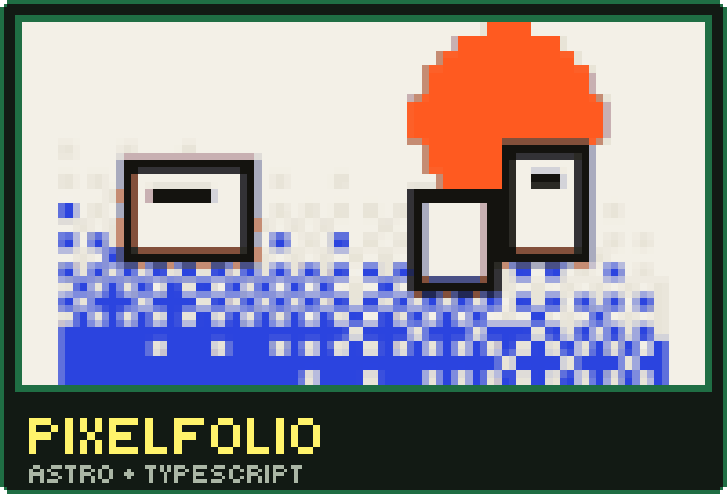</a>
   A portfolio template where the cursor leaves a trail of pixels that cool from lime to navy. <a href="https://github.com/vitermoldy/PixelFolio">v1</a> · <a href="https://github.com/vitermoldy/PixelFoliov2">v2</a>
</td>
<td width="50%" valign="top">
  <a href="https://github.com/vitermoldy/Viygo-Salon-Web">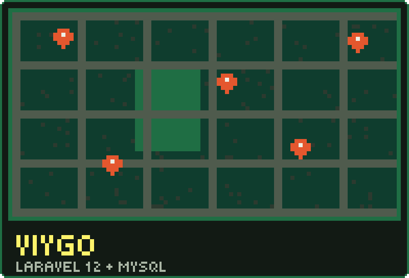</a>
   A salon search and booking site: search, salon pages with a Leaflet map and a three-step booking flow. <a href="https://github.com/vitermoldy/Viygo-Salon-Web">Repo</a>
</td>
</tr>
<tr>
<td width="50%" valign="top">
  <a href="https://github.com/vitermoldy/LandingPage-sitev1">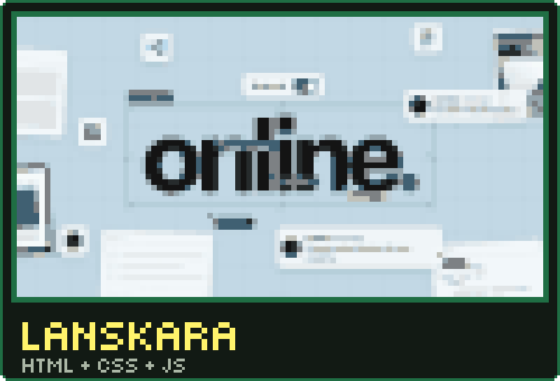</a>
   A landing page for a web studio: a design-canvas hero with labelled cursors, a statement that lights up word by word as you scroll, and a block that turns the whole page dark. <a href="https://github.com/vitermoldy/LandingPage-sitev1">Repo</a>
</td>
<td width="50%" valign="top">
  <a href="https://github.com/vitermoldy/CloudStead">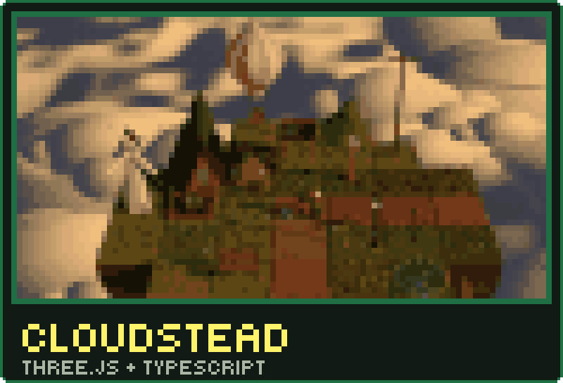</a>
   A study island above the clouds: while your focus timer runs, VMK hauls up new cells, plants and builds, from 9 cells to 37 over 23 hours of focus, with your own YouTube music. <a href="https://github.com/vitermoldy/CloudStead">Repo</a>
</td>
</tr>
</table>

  More: <a href="https://github.com/vitermoldy/Modern-Portofolio-Template">Modern Portfolio</a> ·
  <a href="https://github.com/vitermoldy/Formal-Portofolio-Template">Formal Portfolio</a> ·
  <a href="https://github.com/vitermoldy/Product-Website-v">Medianta</a> ·
  <a href="https://github.com/vitermoldy/Tubes-Proweb">Tubes-Proweb</a> ·
  <a href="https://github.com/vitermoldy/msbd-2026">msbd-2026</a>

<h2>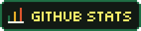</h2>

  
  

  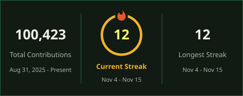

<h2>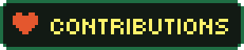</h2>

  <picture>
    <source media="(prefers-color-scheme: dark)" srcset="https://raw.githubusercontent.com/vitermoldy/vitermoldy/output/pacman-contribution-graph-dark.svg">
    
  </picture>

<h2></h2>

  
  
  
  
  

  

